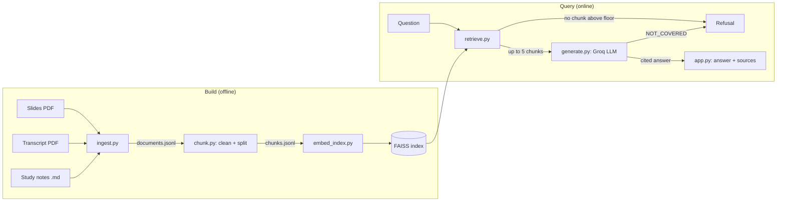

# Architecture: Heapify.Ai

How the app keeps the promises in [contract.md](contract.md).

## Overview

The app has two phases: an offline **build** phase that turns the source material into a vector index, and an online **query** phase that answers one question at a time.

## Components

| File | Responsibility |
|---|---|
| `src/config.py` | Paths, course and lecture names, lecture URL |
| `src/ingest.py` | Load slides and transcript PDFs page by page; split the notes by `##` section; attach metadata |
| `src/chunk.py` | Clean text, drop low-value chunks, split into chunks, assign `chunk_id` |
| `src/embed_index.py` | Embed chunks with `BAAI/bge-small-en-v1.5` and build or load the FAISS index |
| `src/retrieve.py` | Search, apply the relevance floor, remove near-duplicates |
| `src/generate.py` | Build the prompt, call the Groq model, normalise citations, decide refusal and visible sources |
| `app.py` | Gradio chat interface; formats the answer and its sources |
| `tests/` | `probe_retrieval.py` (scores) and `probe_answers.py` (end-to-end behaviour) |

## Data model

Every document and chunk carries this metadata, which is what makes citations possible:

| Field | Meaning |
|---|---|
| `course`, `lecture` | Where the text comes from |
| `kind` | `slides`, `transcript` or `notes` |
| `source_file` | File name the text was read from |
| `locator` | `p.N` for PDFs, the section title for notes |
| `url` | Lecture page on MIT OpenCourseWare |
| `chunk_id` | Position of the chunk in the index |

## Design decisions

### Cleaning and chunking

- Slide text is cleaned of repeated header and footer lines; the OCW license header and speaker tags (`AUDIENCE:`, `[INAUDIBLE]`) and filler lines are removed from the transcript; hyphenated line breaks are re-joined. Cleaning matters because raw transcript noise was matching off-topic queries.
- The title slide and chunks shorter than 80 characters are dropped.
- Slides are split into chunks of about 600 characters with 100 of overlap. Transcript text is split at about 900 characters with 150 of overlap, because spoken text is looser and loses meaning in small pieces. Notes sections are mostly shorter than one chunk and stay whole.
- Notes are excluded from the repeated-line stripper, since short repeated lines there are intentional.

### Embeddings and index

- **`BAAI/bge-small-en-v1.5`**: small enough to run on a free CPU Space, with good retrieval quality for its size.
- **Normalised embeddings with FAISS inner product.** For unit-length vectors the inner product equals cosine similarity, so the score returned by the index is the cosine directly and thresholds mean what they say. (The default L2 index returns squared distance, which gave misleading numbers.)
- **The index is committed** to the repository so the Space starts without recomputing embeddings.

### Retrieval

- Fetch the top 12, keep up to 5.
- **Relevance floor of 0.65.** On the development set, in-scope questions scored about 0.73 to 0.87, clearly unrelated questions about 0.40 to 0.56, and near-miss questions (quicksort, Dijkstra, binary search trees) about 0.71 to 0.76. The floor removes clearly unrelated questions. It cannot separate near-misses from genuine questions, which is why the prompt is the final layer.
- **Near-duplicate removal** (word-overlap above 0.8). The slides repeat the same heading across animation steps, which would otherwise fill the top results with the same text.

### Generation

- A LangChain chain, `ChatPromptTemplate | ChatGroq | StrOutputParser`, at temperature 0 with a 700-token cap.
- The system prompt restricts the model to the numbered excerpts, defines the `NOT_COVERED` reply, requires `[n]` citations, asks for plain-text math, and tells the model to treat the user's text as a question rather than as instructions.
- The model name comes from the `GROQ_MODEL` environment variable, because available models change over time.
- Citation markers are normalised after generation (`【1】`, `[[1]]` and `[1,2]` all become `[1]`), and only cited excerpts are shown as sources. A refusal returns no sources, so a refused answer never appears to be backed by material.

### Why refusals have three layers

| Layer | Catches | Cost |
|---|---|---|
| Clean chunks | Junk text matching by accident | Done once, at build time |
| Relevance floor | Clearly unrelated questions, with no model call | None |
| Strict prompt | Near-miss questions the lecture does not answer, and injection attempts | One model call |

## Failure modes

| Failure | Behaviour |
|---|---|
| No excerpt above the floor | Refusal, no model call |
| Model replies `NOT_COVERED` | Refusal, no sources |
| Missing `GROQ_API_KEY` | Clear error at first query |
| Groq model unavailable or rate limited | The app returns the contract's error message |
| Source error (a wrong statement in the slides, transcript or notes) | The answer can repeat it; fix the source and rebuild the index |

## Deployment

The app runs as a Gradio Space on Hugging Face. The committed `index/` folder and the `data/` sources ship with the repository; the Groq key is a Space secret. To change the knowledge base, edit the files in `data/`, then run `python -m src.ingest`, `python -m src.chunk` and `python -m src.embed_index`, and commit the new `index/`.

## Evaluation

`tests/probe_retrieval.py` shows the similarity scores behind each decision. `tests/probe_answers.py` checks the end-to-end behaviour against the questions in [concept.md](concept.md). Both should be re-run after any change to the sources, chunking, floor, prompt or model.